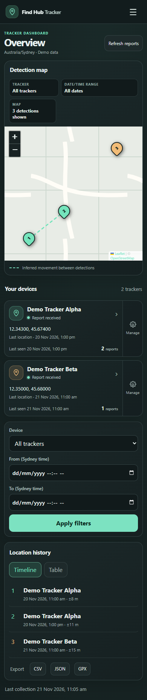
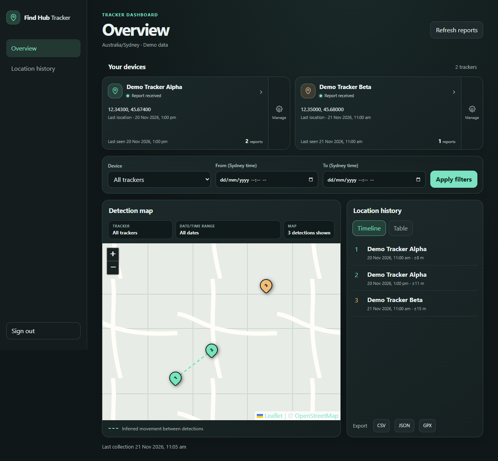

# Find Hub Tracker

A self-hosted dashboard for collecting and reviewing location reports from devices in your own Google Find Hub account.

> **Unofficial integration.** The Google Find Hub collector is a community project, not a Google product. Google can change its service or authentication flow at any time. This repository is an unpublished release candidate; do not treat it as a supported Google integration.

## Screenshots

These screenshots use synthetic demo devices, dates, and map tiles. They contain no live account or location data.

| Mobile dashboard | Desktop dashboard |
|---|---|
|  |  |

## Features

- Interactive Leaflet map, location history timeline/table, date filtering, and Australia/Sydney timestamp display.
- Independent per-installation PostgreSQL history and Docker volumes.
- Separate tracker password login and collector HTTP Basic authentication.
- Automatic device discovery and staggered collection scheduling.
- Optional Caddy HTTPS configuration.
- Checksummed backup/restore helpers with locking, restricted file permissions, and 14 verified-backup retention.
- Device management with owner authentication, CSRF checks, confirmation steps, and recovery checkpoints.

The project does not provide Google services, guarantee device reports, or bypass Google account verification or encrypted-location confirmation.

## Supported systems

The release candidate targets:

- Windows 10/11 x64 with Docker Desktop using Linux containers. The Windows first-run installation was not validated on a working Docker Desktop engine for this release preparation.
- Linux x86_64/amd64 with Docker Engine and the Compose v2 plugin. The portable Linux stack was previously built and exercised in isolated Ubuntu QA.
- Python 3.11 or newer is required on the host for first-run setup and backup tools.

ARM64 is not validated and the setup helper rejects unverified architectures. Allow at least 4 CPU cores, 5 GB RAM available to Docker, and 10 GB free disk; the collector includes a browser runtime. Builds and Google sign-in require internet access.

## Install

Choose the full guide for your system:

- [Windows installation](INSTALL_WINDOWS.md)
- [Linux installation](INSTALL_LINUX.md)

In brief, extract the package to a new directory, run ./setup.ps1 on Windows or sh ./setup.sh on Linux, and choose a unique dashboard password when prompted. The default dashboard is at http://127.0.0.1:8080.

Collector setup is separate. From the installation folder run python portable_setup.py collector-login (use python3 on Linux), then open http://127.0.0.1:4321/auth on the same computer. In the collector configuration page, use its Google sign-in flow and authenticate with the account that owns the devices. Complete Google's encrypted-location confirmation if requested. Do not use credentials from another installation.

The dashboard and collector bind to loopback by default. Remote access requires a deliberately configured private network or reviewed HTTPS setup; do not publish raw ports 8080, 4321, or 5432 to the internet.

## Privacy and security

Each installation creates its own random database, session, ingestion, collector HTTP Basic, and collector encryption secrets. No credentials, Google session state, location history, or device list are bundled. The dashboard password is stored as an Argon2id hash. PostgreSQL and persistent state use Compose-scoped volumes.

Location history is sensitive. Protect the host account, project directory, Docker volumes, and backups. Backups include Google collector authentication/encryption state and must be handled like credentials. See SECURITY.md and BACKUP_RESTORE.md.

The app and optional proxy share a project-scoped bridge network so loopback port forwarding works; the collector is not on that proxy network and uses a separate network for Google access. See CONFIGURATION.md for network boundaries and optional HTTPS tradeoffs.

## Google account and limitations

The collector is based on the pinned GoogleFindMyToolsWebUi and GoogleFindMyTools projects. They are unofficial community integrations. Authentication, encrypted report decryption, supported device categories, report availability, and compatibility may change without notice. Follow Google's account prompts; do not bypass security checks. See TROUBLESHOOTING.md.

## Backups, updates, and uninstall

- [Backup and restore](BACKUP_RESTORE.md)
- [Configuration and updates](CONFIGURATION.md)
- [Troubleshooting](TROUBLESHOOTING.md)

Backups are not automatically scheduled by default. Schedule the documented command using the host's scheduler if desired. Back up and verify before an update. docker compose down preserves this installation's named volumes; do not add -v unless intentionally removing this installation's data after a verified export. Never use system-wide Docker prune commands for this project.

## Documentation

- [Configuration](CONFIGURATION.md)
- [Security and privacy](SECURITY.md)
- [Third-party licenses](THIRD_PARTY_LICENSES.md)
- [Changelog](CHANGELOG.md)
- [Release notes](RELEASE_NOTES_v0.1.0-rc1.md)
- [License recommendation (pending approval)](LICENSE_RECOMMENDATION.md)

## Acknowledgements

Find Hub Tracker builds on the community work in [GoogleFindMyToolsWebUi](https://github.com/P6g9YHK6/GoogleFindMyToolsWebUi) and [GoogleFindMyTools](https://github.com/leonboe1/GoogleFindMyTools). The interactive map uses [Leaflet](https://leafletjs.com/) and © [OpenStreetMap contributors](https://www.openstreetmap.org/copyright). These projects and their respective maintainers are independent of Find Hub Tracker. Google and Find Hub are Google trademarks; this project is not affiliated with or endorsed by Google.

## License status

The project-wide license has not been approved or finalized. The pinned collector and its patch are GPL-3.0; the source package includes their notices and license texts. Do not assume this repository grants permission to redistribute the project's original code until the maintainer approves a license. See LICENSE_RECOMMENDATION.md.
